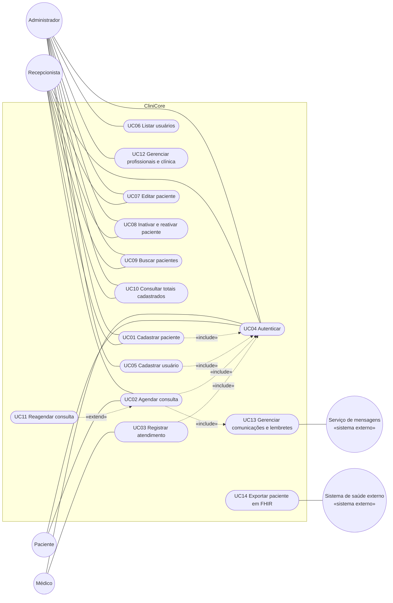

# Casos de uso

> Seção 6 do modelo. Os **requisitos** (RF) e seus **cenários de aceitação** estão em `openspec/specs/`.
> Aqui ficam o diagrama com **todos** os casos de uso e a descrição detalhada **apenas dos 3 mais importantes**.

## 6.1 Diagrama de casos de uso

O diagrama abaixo usa Mermaid, que o GitHub desenha direto na página. A versão em UML formal (PlantUML) está em [`casos-de-uso.puml`](casos-de-uso.puml).

Para o diagrama continuar legível, só algumas setas «include» até UC04 aparecem: **todos os casos de uso, exceto UC14, incluem UC04 Autenticar**, porque toda funcionalidade exige sessão (NF-SEG-02). O UC14 é usado por um sistema externo, não por uma pessoa.

Quem acessa cada caso de uso segue a matriz de permissões do NF-SEG-02: o Administrador gerencia usuários e pacientes; o Recepcionista gerencia pacientes; o Médico e o Paciente acessam apenas a página inicial até que os casos de uso de agenda e atendimento sejam implementados.

## Índice e rastreabilidade

| Caso de uso | Ator principal | Requisitos | Situação | Descrição detalhada |
|---|---|---|---|---|
| UC01 Cadastrar paciente | Recepcionista, Administrador | RF01, RF11, NF-PRI-01 | Implementado (`/patients/new`, `POST /api/patients`) | [uc01-cadastrar-paciente.md](uc01-cadastrar-paciente.md) |
| UC02 Agendar consulta | Recepcionista, Paciente | RF03, RF05 | Só na visão | — |
| UC03 Registrar atendimento | Médico | RF04 | Só na visão | — |
| UC04 Autenticar | Todos | RF06, NF-SEG-02, NF-SEG-03 | Implementado (`/login`, `/api/auth/session`) | — |
| UC05 Cadastrar usuário | Administrador | RF07, RF08, RF09, RF16, NF-SEG-01, NF-MAN-01, NF-CON-01 | Implementado (`/users/new`, `/setup`, `POST /api/users`, `POST /api/auth/first-administrator`) | [uc05-cadastrar-usuario.md](uc05-cadastrar-usuario.md) |
| UC06 Listar usuários | Administrador | RF10, NF-SEG-01, NF-MAN-01, NF-CON-01 | Implementado (`/users`, `GET /api/users`) | — |
| UC07 Editar paciente | Recepcionista, Administrador | RF11, RF12 | Implementado (`/patients/<id>`, `PUT /api/patients/<id>`) | [uc07-editar-paciente.md](uc07-editar-paciente.md) |
| UC08 Inativar e reativar paciente | Recepcionista, Administrador | RF13 | Implementado (`/patients`, `/patients/<id>`, `PATCH /api/patients/<id>`) | — |
| UC09 Buscar pacientes | Recepcionista, Administrador | RF14, NF-DES-01 | Implementado (`/patients`, `GET /api/patients`) | — |
| UC10 Consultar totais cadastrados | Recepcionista, Administrador | RF15 | Implementado (`/`) | — |
| UC11 Reagendar consulta | Recepcionista, Paciente | RF03, RF05 | Só na visão | — |
| UC12 Gerenciar profissionais e clínica | Administrador | RF02 | Só na visão | — |
| UC13 Gerenciar comunicações e lembretes | Serviço de mensagens | RF03, RF05 | Só na visão | — |
| UC14 Exportar paciente em FHIR | Sistema de saúde externo | NF-INT-01 | Só na visão | — |

As telas e as rotas de API chamam a camada de negócio pela fachada `FacadeSingletonController` (`src/modules/facade/`), que verifica a permissão do papel antes de cada operação. As telas citadas estão em [`06-interface/`](../06-interface/README.md).

**Regra:** depois da primeira entrega, IDs de casos de uso **não** são renumerados nem reaproveitados.
