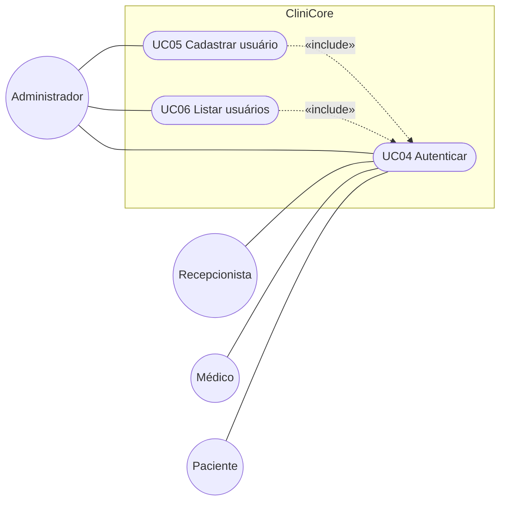

# Casos de uso

> Seção 6 do modelo. Os **requisitos** (RF) e seus **cenários de aceitação** estão em `openspec/specs/`.
> Aqui ficam o diagrama com **todos** os casos de uso e a descrição detalhada **apenas dos 3 mais importantes**.

## 6.1 Diagrama de casos de uso — gerenciamento de usuários

O diagrama abaixo usa Mermaid, que o GitHub desenha direto na página. A versão em UML formal (PlantUML) está em [`casos-de-uso.puml`](casos-de-uso.puml). Os casos de uso UC01–UC03 (Cadastrar paciente, Agendar consulta, Registrar atendimento) estão no [documento de requisitos](../relatorio/main.pdf) e entram neste diagrama na Entrega 2.

## Índice e rastreabilidade

| Caso de uso | Ator principal | Requisitos | Situação | Descrição detalhada |
|---|---|---|---|---|
| UC04 Autenticar | Todos | RF06, NF-SEG-02, NF-SEG-03 | Planejado | — |
| UC05 Cadastrar usuário | Administrador | RF07, RF08, RF09, NF-SEG-01, NF-MAN-01, NF-CON-01 | Implementado (`POST /api/users`) | — |
| UC06 Listar usuários | Administrador | RF10, NF-SEG-01, NF-MAN-01, NF-CON-01 | Implementado (`GET /api/users`) | — |

UC05 e UC06 estão implementados na rota `/api/users` (`src/app/api/users/route.ts`), que chama `UserController.add` e `UserController.list` (`src/modules/users`). As telas e a restrição ao Administrador dependem de UC04.

**Regra:** depois da primeira entrega, IDs de casos de uso **não** são renumerados nem reaproveitados.
