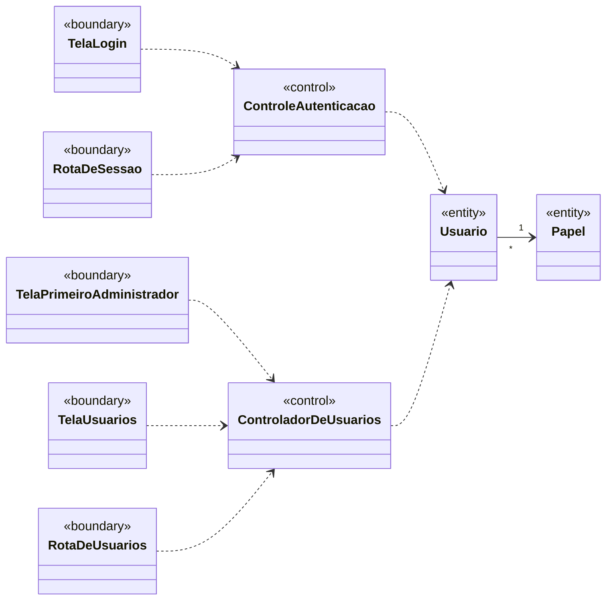
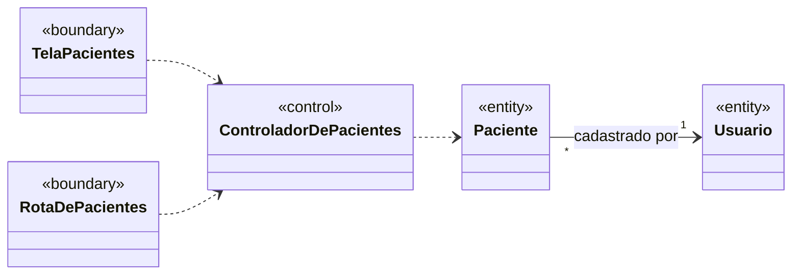

# Análise de casos de uso — diagrama de classes de análise

> Seção 7 do modelo. Classes **sem atributos e métodos**, mas com os relacionamentos já definidos.
> Estereótipos ICONIX: «boundary» (fronteira), «control» (controle), «entity» (entidade).
> Os nomes vêm do [glossário](02-glossario.md); o nome de cada classe no código está na tabela ao final.

## Autenticação e gerenciamento de usuários

## Gerenciamento de pacientes

A fronteira **TelaPacientes** reúne a lista de pacientes (TL03) e o cadastro e a edição (TL04). Todas as fronteiras chegam aos controles pela fachada única (`FacadeSingletonController`), que é uma decisão de projeto e por isso aparece só no [diagrama de classes de projeto](08-projeto.md). A permissão de cada papel (NF-SEG-02) é verificada nesse caminho, antes do controle.

O modelo de domínio completo da clínica (Paciente, Profissional, Agenda, Agendamento, Atendimento e demais recursos FHIR) está em [`classes-de-analise.puml`](relatorio/codigos/classes-de-analise.puml).

## Rastreabilidade caso de uso → classes de controle

| Caso de uso | Controle | Fronteiras |
|---|---|---|
| UC01 Cadastrar paciente | ControladorDePacientes | TelaPacientes (`/patients/new`), RotaDePacientes (`POST /api/patients`) |
| UC04 Autenticar | ControleAutenticacao | TelaLogin (`/login`), RotaDeSessao (`POST` e `DELETE /api/auth/session`) |
| UC05 Cadastrar usuário | ControladorDeUsuarios | TelaUsuarios (`/users/new`), TelaPrimeiroAdministrador (`/setup`), RotaDeUsuarios (`POST /api/users`, `POST /api/auth/first-administrator`) |
| UC06 Listar usuários | ControladorDeUsuarios | TelaUsuarios (`/users`), RotaDeUsuarios (`GET /api/users`) |
| UC07 Editar paciente | ControladorDePacientes | TelaPacientes (`/patients/<id>`), RotaDePacientes (`PUT /api/patients/<id>`) |
| UC08 Inativar e reativar paciente | ControladorDePacientes | TelaPacientes (`/patients`, `/patients/<id>`), RotaDePacientes (`PATCH /api/patients/<id>`) |
| UC09 Buscar pacientes | ControladorDePacientes | TelaPacientes (`/patients`), RotaDePacientes (`GET /api/patients`, `GET /api/patients/<id>`) |
| UC10 Consultar totais cadastrados | ControladorDeUsuarios, ControladorDePacientes | Página inicial (`/`) |

## Correspondência com o código

| Classe de análise | No código | Situação |
|---|---|---|
| ControladorDeUsuarios | `UserController` (`src/modules/users/user-controller.ts`) | Implementado |
| ControleAutenticacao | `AuthenticationController` (`src/modules/auth/authentication-controller.ts`) | Implementado |
| ControladorDePacientes | `PatientController` (`src/modules/patients/patient-controller.ts`) | Implementado |
| Usuario | `User` (`src/modules/users/user.ts`), tabela `users` | Implementado |
| Papel | `Role` (`src/modules/users/role.ts`) | Implementado |
| Paciente | `Patient` (`src/modules/patients/patient.ts`), tabela `patients`; "cadastrado por" é `createdBy`, chave estrangeira para `users.id` | Implementado |
| TelaLogin | página `/login` (`src/app/[locale]/(auth)/login/`) | Implementado |
| TelaPrimeiroAdministrador | página `/setup` (`src/app/[locale]/(auth)/setup/`) | Implementado |
| RotaDeSessao | rota `/api/auth/session` (`src/app/api/auth/session/route.ts`) | Implementado |
| TelaUsuarios | páginas `/users` e `/users/new` (`src/app/[locale]/(app)/users/`) | Implementado |
| RotaDeUsuarios | rotas `/api/users` (`src/app/api/users/route.ts`) e `/api/auth/first-administrator` (`src/app/api/auth/first-administrator/route.ts`) | Implementado |
| TelaPacientes | páginas `/patients`, `/patients/new` e `/patients/<id>` (`src/app/[locale]/(app)/patients/`) | Implementado |
| RotaDePacientes | rotas `/api/patients` (`src/app/api/patients/route.ts`) e `/api/patients/[id]` (`src/app/api/patients/[id]/route.ts`) | Implementado |
