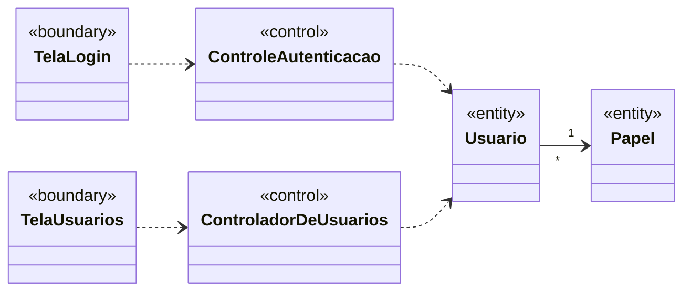

# Análise de casos de uso — diagrama de classes de análise

> Seção 7 do modelo. Classes **sem atributos e métodos**, mas com os relacionamentos já definidos.
> Estereótipos ICONIX: «boundary» (fronteira), «control» (controle), «entity» (entidade).
> Os nomes vêm do [glossário](02-glossario.md); o nome de cada classe no código está na tabela ao final.

## Gerenciamento de usuários

O modelo de domínio completo da clínica (Paciente, Profissional, Agenda, Agendamento, Atendimento e demais recursos FHIR) está em [`classes-de-analise.puml`](relatorio/codigos/classes-de-analise.puml).

## Rastreabilidade caso de uso → classes de controle

| Caso de uso | Controle | Fronteiras |
|---|---|---|
| UC04 Autenticar | ControleAutenticacao | TelaLogin |
| UC05 Cadastrar usuário | ControladorDeUsuarios | TelaUsuarios |
| UC06 Listar usuários | ControladorDeUsuarios | TelaUsuarios |

## Correspondência com o código

| Classe de análise | No código | Situação |
|---|---|---|
| ControladorDeUsuarios | `UserController` (`src/modules/users/user-controller.ts`) | Implementado |
| Usuario | `User` (`src/modules/users/user.ts`), tabela `users` | Implementado |
| Papel | `Role` (`src/modules/users/role.ts`) | Implementado |
| ControleAutenticacao | — | Planejado (UC04) |
| TelaLogin | página `src/app/[locale]/login` | Planejado (UC04) |
| TelaUsuarios | página `src/app/[locale]/users` | Planejado |
