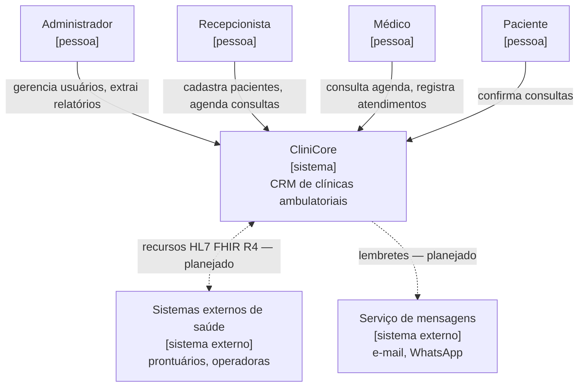
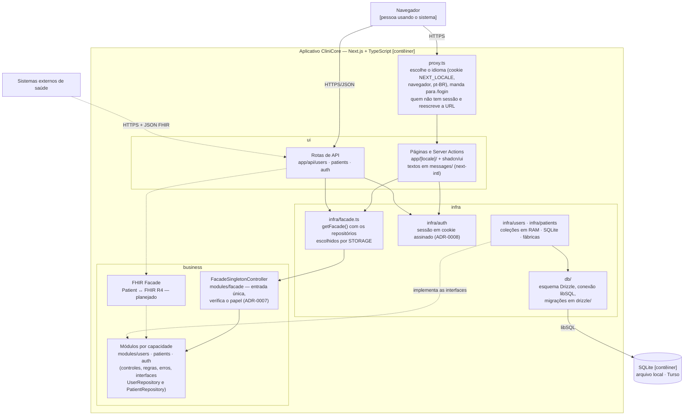
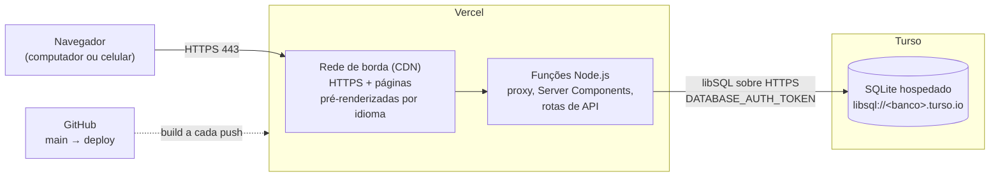
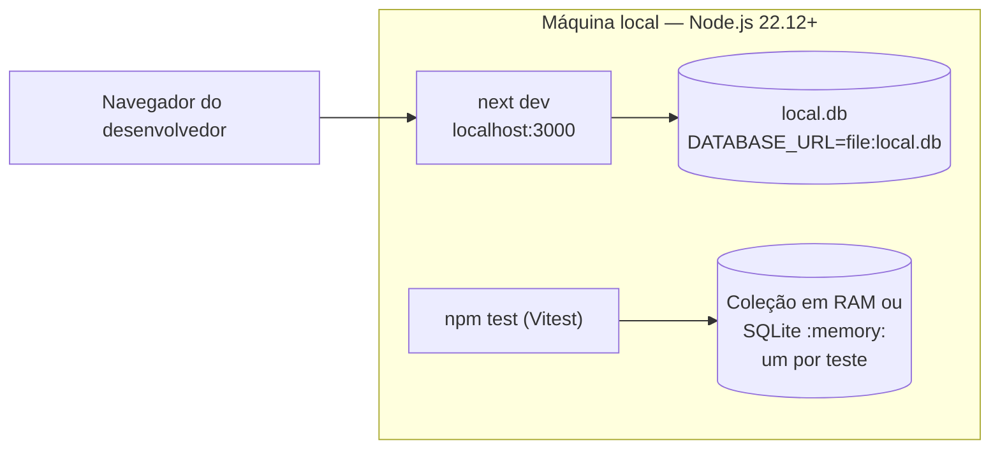

# Arquitetura

> Seção 9 do modelo. Pelo menos um diagrama de arquitetura **lógica** e um de arquitetura **física**, e a explicação de **como cada requisito não funcional é atendido**.
> Diagramas no estilo [C4](https://c4model.com/). Decisões importantes ficam registradas como ADRs em [`adr/`](adr/).
> Os nomes das classes e pastas são os do código, em inglês ([ADR-0005](adr/0005-ingles-no-codigo-e-i18n.md)). Elementos marcados como *planejado* ainda não existem no código.

## 9.1 Contexto (C4 nível 1)

## 9.2 Arquitetura lógica — contêineres e camadas (C4 nível 2)

O CliniCore é um único aplicativo **Next.js** (App Router) em **TypeScript**, que entrega a interface e o servidor no mesmo deploy, e persiste os dados em **SQLite** pelo **Drizzle ORM** ([ADR-0004](adr/0004-nextjs-typescript-sqlite.md)). É um monolito modular ([ADR-0001](adr/0001-monolito-modular.md)): dentro do aplicativo, as camadas da disciplina correspondem a pastas, e as dependências apontam sempre para dentro: **ui** → **business** → **infra**.

| Camada | Pasta | Responsabilidade | Não pode depender de |
|---|---|---|---|
| ui | `src/app/`, `src/components/`, `src/i18n/`, `messages/` | Telas, Server Actions, rotas de API, tradução dos textos e dos códigos de erro | — |
| business | `src/modules/<capacidade>/` | Fachada única (`FacadeSingletonController`), entidades, validação, erros de domínio, permissões por papel, controles (`UserController`, `AuthenticationController`, `PatientController`) e as interfaces dos repositórios | `src/app`, `src/infra`, `src/db`, React |
| infra | `src/infra/`, `src/db/` | Montagem da fachada (`getFacade`), sessão, implementações dos repositórios (coleção em RAM e SQLite), fábricas que escolhem uma na inicialização, esquema, conexão, migrações e identificação de erros do banco | `src/app` |

Telas, Server Actions e rotas de API chamam só a fachada, que verifica o papel do usuário em cada operação e delega ao controle ([ADR-0007](adr/0007-fachada-unica.md)). Os controles recebem a interface do repositório pelo construtor ([ADR-0006](adr/0006-repositorio-de-usuarios.md)). Em produção, `getFacade()` entrega à fachada as implementações escolhidas pela variável `STORAGE`: coleções em RAM (`InMemoryUserRepository`, `InMemoryPatientRepository`) ou SQLite (`SqliteUserRepository`, `SqlitePatientRepository`, banco na `DATABASE_URL`). Nos testes, os controles usam as coleções em RAM, e as implementações de cada entidade passam pelos mesmos testes de contrato. A sessão é um cookie assinado com `SESSION_SECRET` ([ADR-0008](adr/0008-sessao-em-cookie-assinado.md)).

## 9.3 Arquitetura física — implantação

### Produção (planejado)

A Vercel não tem sistema de arquivos permanente, por isso o banco de produção é o Turso, e não um arquivo SQLite local. As migrações são aplicadas no Turso com `npm run db:migrate` antes de publicar uma versão que altere o esquema.

### Desenvolvimento e testes

| Ambiente | `STORAGE` | `DATABASE_URL` | Onde os dados ficam |
|---|---|---|---|
| Testes | — | `:memory:` nos testes do SQLite | Coleção em RAM ou SQLite em memória; somem ao fim de cada teste |
| Desenvolvimento | `sqlite` ou `memory` | `file:local.db` | Arquivo local, fora do Git, ou coleção em RAM |
| Produção | `sqlite` | `libsql://<banco>.turso.io` | Turso |

## 9.4 Como cada requisito não funcional é atendido

Os requisitos estão em [`openspec/specs/rnf/`](../../openspec/specs/rnf/). Os que vieram do [documento de requisitos](../relatorio/main.pdf) citam o ID original (NF01–NF06) na descrição.

| RNF | Decisão / tática arquitetural | Onde | Situação |
|---|---|---|---|
| NF-SEG-01 Senha nunca exibida nem armazenada em texto puro | Só o hash scrypt com salt aleatório de 16 bytes é gravado (`users.password_hash`); os repositórios devolvem só os campos públicos, e o hash sai apenas de `findCredentials`, para o login; erros de validação carregam um código, nunca a senha digitada; a tela nunca devolve a senha ao campo depois de uma recusa | `modules/users/password.ts`, `infra/users/` | Implementado |
| NF-MAN-01 Persistência substituível | Os controles dependem só das interfaces `UserRepository` e `PatientRepository`; a variável `STORAGE` escolhe na inicialização as coleções em RAM ou o SQLite para todas as entidades; testes de contrato garantem o mesmo comportamento nos dois | `modules/*/…-repository.ts`, `infra/users/`, `infra/patients/` · [ADR-0006](adr/0006-repositorio-de-usuarios.md) | Implementado |
| NF-CON-01 Falha de armazenamento tratada | Toda operação do banco passa por `accessStorage`, que converte a falha em `UserPersistenceError` ou `PatientPersistenceError` sem encerrar o processo; as rotas respondem 503 e as telas mostram uma mensagem com "Tentar novamente"; e-mail, login e CPF repetidos são barrados por índices únicos | `infra/*/sqlite-*-repository.ts`, `app/[locale]/(app)/error.tsx` · [ADR-0002](adr/0002-unicidade-no-banco.md) | Implementado |
| NF-USA-01 Operações encontradas em ≤ 10 s | Menu lateral só com as áreas do papel, atalhos "Novo paciente" e "Novo usuário" na página inicial; componentes padronizados do shadcn/ui; interface em pt-BR e en, com a mensagem específica de cada regra ao lado do campo | `components/`, `app/[locale]/(app)/`, `messages/` · [ADR-0005](adr/0005-ingles-no-codigo-e-i18n.md) | Implementado; falta o teste com usuários |
| NF-SEG-02 Autenticação e autorização por papel (RBAC) | Login por login ou e-mail com sessão em cookie assinado de 8 horas; o proxy manda para `/login` quem não tem sessão; a fachada verifica o papel em cada operação (`hasPermission`) e as rotas respondem 401 ou 403 | `modules/auth/`, `modules/facade/`, `infra/auth/`, `proxy.ts` · [ADR-0007](adr/0007-fachada-unica.md), [ADR-0008](adr/0008-sessao-em-cookie-assinado.md) | Implementado |
| NF-SEG-03 Tráfego criptografado (TLS 1.2+) | A Vercel só serve HTTPS; a conexão com o Turso usa `libsql://` sobre TLS | Implantação | Planejado (deploy) |
| NF-DES-01 Buscas em ≤ 2 s (p95) | A busca de pacientes filtra no banco, numa só consulta, pela coluna `search_name` (nome sem acentos, indexada) ou pelo CPF; consultas no mesmo processo, sem saltos de rede entre interface e servidor; casca das páginas pré-renderizada na CDN | `infra/patients/sqlite-patient-repository.ts`, `db/schema.ts`, Vercel | Implementado para pacientes, sem medição com 10.000 registros; agenda planejada |
| NF-PRI-01 Adequação à LGPD | Senhas só como hash; dados acessíveis apenas a usuários autenticados com o papel certo (NF-SEG-02); base legal obrigatória no cadastro do paciente (`legalBasis`); relatórios analíticos pseudonimizados; logs sem senha nem CPF | `modules/users/password.ts`, `modules/patients/legal-basis.ts` | Parcial: relatórios planejados |
| NF-INT-01 Interoperabilidade HL7 FHIR R4 | FHIR Facade na camada business convertendo as entidades internas em recursos FHIR (`Patient`), exposta por rotas de API | `modules/` (planejado) | Planejado |
