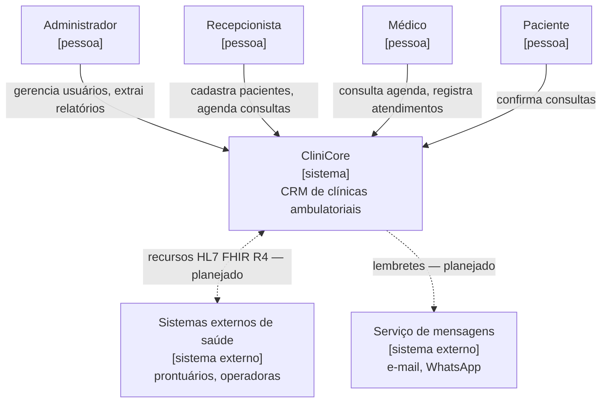
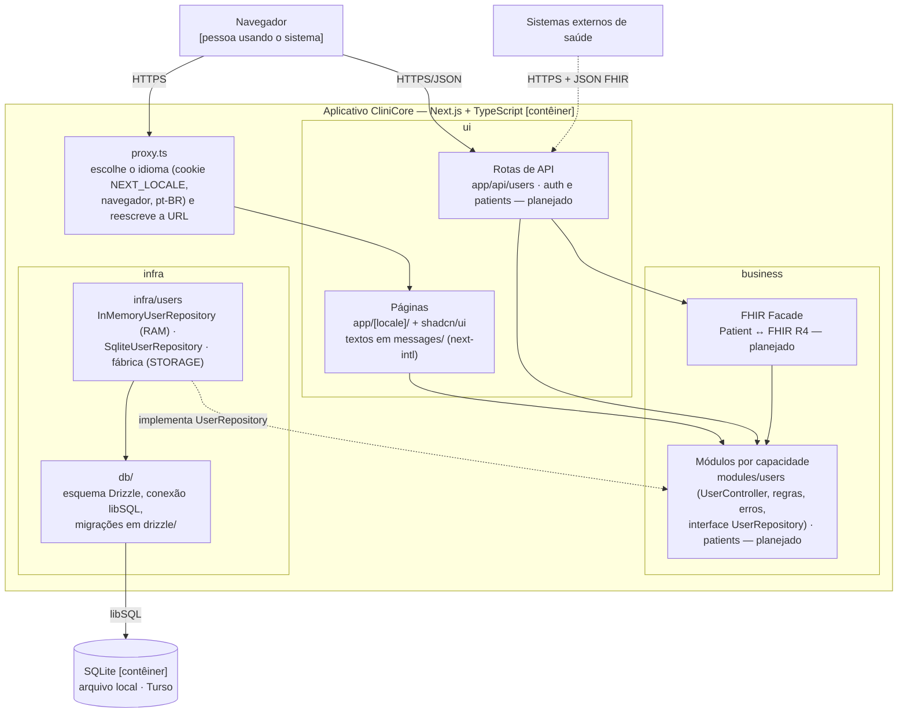
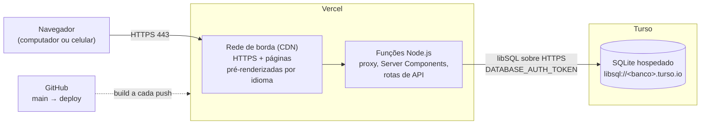
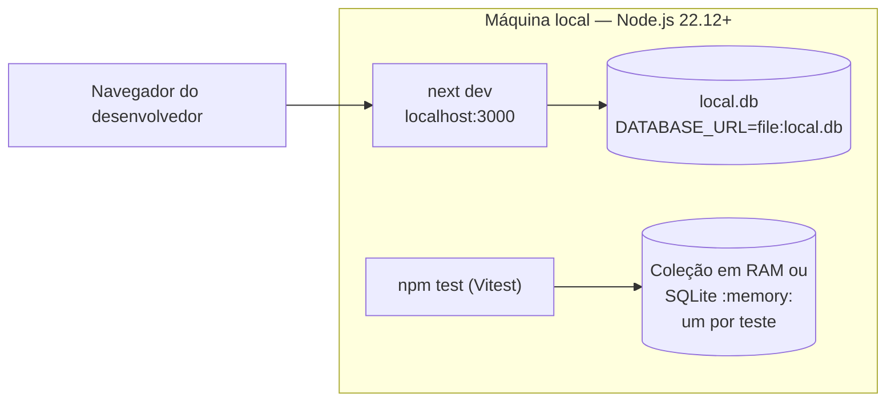

# Arquitetura

> Seção 9 do modelo. Pelo menos um diagrama de arquitetura **lógica** e um de arquitetura **física**, e a explicação de **como cada requisito não funcional é atendido**.
> Diagramas no estilo [C4](https://c4model.com/). Decisões importantes ficam registradas como ADRs em [`adr/`](adr/).
> Os nomes das classes e pastas são os do código, em inglês ([ADR-0005](adr/0005-ingles-no-codigo-e-i18n.md)). Elementos marcados como *planejado* ainda não existem no código.

## 9.1 Contexto (C4 nível 1)

## 9.2 Arquitetura lógica — contêineres e camadas (C4 nível 2)

O CliniCore é um único aplicativo **Next.js** (App Router) em **TypeScript**, que entrega a interface e o servidor no mesmo deploy, e persiste os dados em **SQLite** pelo **Drizzle ORM** ([ADR-0004](adr/0004-nextjs-typescript-sqlite.md)). É um monolito modular ([ADR-0001](adr/0001-monolito-modular.md)): dentro do aplicativo, as camadas da disciplina correspondem a pastas, e as dependências apontam sempre para dentro: **ui** → **business** → **infra**.

| Camada | Pasta | Responsabilidade | Não pode depender de |
|---|---|---|---|
| ui | `src/app/`, `src/components/ui/`, `src/i18n/`, `messages/` | Telas, rotas de API, tradução dos textos e dos códigos de erro | — |
| business | `src/modules/<capacidade>/` | Entidades, validação, erros de domínio, controles (`UserController`) e a interface do repositório (`UserRepository`) | `src/app`, `src/infra`, `src/db`, React |
| infra | `src/infra/<capacidade>/`, `src/db/` | Implementações do repositório (coleção em RAM e SQLite), fábrica que escolhe uma na inicialização, esquema, conexão, migrações e identificação de erros do banco | `src/app` |

Os controles recebem a interface `UserRepository` pelo construtor ([ADR-0006](adr/0006-repositorio-de-usuarios.md)). Em produção, `getUserRepository()` cria uma única implementação a partir da variável `STORAGE`: `InMemoryUserRepository` (coleção em RAM) ou `SqliteUserRepository` (banco na `DATABASE_URL`). Nos testes, o controle usa a coleção em RAM, e as duas implementações passam pelos mesmos testes de contrato.

## 9.3 Arquitetura física — implantação

### Produção (planejado)

A Vercel não tem sistema de arquivos permanente, por isso o banco de produção é o Turso, e não um arquivo SQLite local. As migrações são aplicadas no Turso com `npm run db:migrate` antes de publicar uma versão que altere o esquema.

### Desenvolvimento e testes

| Ambiente | `STORAGE` | `DATABASE_URL` | Onde os dados ficam |
|---|---|---|---|
| Testes | — | `:memory:` nos testes do SQLite | Coleção em RAM ou SQLite em memória; somem ao fim de cada teste |
| Desenvolvimento | `sqlite` ou `memory` | `file:local.db` | Arquivo local, fora do Git, ou coleção em RAM |
| Produção | `sqlite` | `libsql://<banco>.turso.io` | Turso |

## 9.4 Como cada requisito não funcional é atendido

Os requisitos estão em [`openspec/specs/rnf/`](../../openspec/specs/rnf/). Os que vieram do [documento de requisitos](../relatorio/main.pdf) citam o ID original (NF01–NF06) na descrição.

| RNF | Decisão / tática arquitetural | Onde | Situação |
|---|---|---|---|
| NF-SEG-01 Senha nunca exibida nem armazenada em texto puro | Só o hash scrypt com salt aleatório de 16 bytes é gravado (`users.password_hash`); os repositórios devolvem só os campos públicos, sem a senha nem o hash; erros de validação carregam um código, nunca a senha digitada | `modules/users/password.ts`, `infra/users/` | Implementado |
| NF-MAN-01 Persistência substituível | O controle depende só da interface `UserRepository`; a fábrica escolhe na inicialização, pela variável `STORAGE`, a coleção em RAM ou o SQLite; testes de contrato garantem o mesmo comportamento nos dois | `modules/users/user-repository.ts`, `infra/users/` · [ADR-0006](adr/0006-repositorio-de-usuarios.md) | Implementado |
| NF-CON-01 Falha de armazenamento tratada | Toda operação do banco passa por `SqliteUserRepository.accessStorage`, que converte a falha em `UserPersistenceError` sem encerrar o processo; e-mail e login repetidos são barrados por índices únicos no banco | `infra/users/sqlite-user-repository.ts` · [ADR-0002](adr/0002-unicidade-no-banco.md) | Implementado |
| NF-USA-01 Operações encontradas em ≤ 10 s | Componentes padronizados do shadcn/ui; interface em pt-BR e en, com mensagens de erro traduzidas a partir de códigos estáveis | `components/ui/`, `messages/` · [ADR-0005](adr/0005-ingles-no-codigo-e-i18n.md) | Parcial: telas planejadas |
| NF-SEG-02 Autenticação e autorização por papel (RBAC) | Papel do usuário como enumeração (`Role`); login com sessão e verificação do papel nas rotas | `modules/users/role.ts` | Parcial: login planejado |
| NF-SEG-03 Tráfego criptografado (TLS 1.2+) | A Vercel só serve HTTPS; a conexão com o Turso usa `libsql://` sobre TLS | Implantação | Planejado (deploy) |
| NF-DES-01 Buscas em ≤ 2 s (p95) | Consultas SQL no mesmo processo, sem saltos de rede entre interface e servidor; índices nas colunas de busca; páginas pré-renderizadas na CDN | `db/schema.ts`, Vercel | Planejado (busca de pacientes) |
| NF-PRI-01 Adequação à LGPD | Senhas só como hash; dados acessíveis apenas a usuários autenticados (NF-SEG-02); base legal registrada no cadastro do paciente; relatórios analíticos pseudonimizados; logs sem senha nem CPF | `modules/users/password.ts` | Parcial |
| NF-INT-01 Interoperabilidade HL7 FHIR R4 | FHIR Facade na camada business convertendo as entidades internas em recursos FHIR (`Patient`), exposta por rotas de API | `modules/` (planejado) | Planejado |
