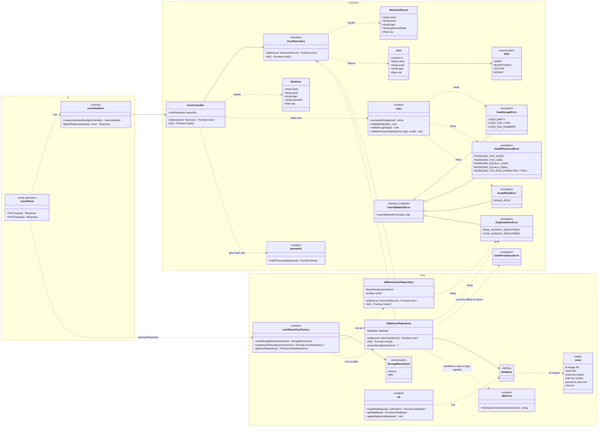

# Projeto detalhado — pacotes, classes de projeto e padrões

> Não existia no modelo .docx. Aqui fica o **diagrama de classes de projeto**, que evolui a cada sprint, diferente do diagrama de **análise** (`05-analise.md`), que é conceitual e muda pouco.
> Atualize este arquivo em **toda** sprint (ver [cronograma](00-entregas.md)). Os nomes de classes são os do código, em inglês ([ADR-0005](07-arquitetura/adr/0005-ingles-no-codigo-e-i18n.md)).

## 1. Divisão de pacotes

As camadas da disciplina (**ui**, **business** e **infra**) correspondem às pastas do aplicativo Next.js:

```text
src/
├── app/                ← ui: páginas em app/[locale]/ e rotas de API em app/api/
│   └── api/users/
│       ├── route.ts            ← fronteira: GET e POST /api/users
│       └── users-handlers.ts   ← requisição → UserController; erro → resposta com código e mensagem
├── components/ui/      ← ui: componentes shadcn/ui
├── modules/            ← business: uma pasta por capacidade
│   └── users/
│       ├── user.ts             ← entidade: User, NewUser
│       ├── role.ts             ← enumeração: Role
│       ├── rules.ts            ← validação de login, senha e papel
│       ├── password.ts         ← hash da senha
│       ├── errors.ts           ← exceções: InvalidLoginError, InvalidPasswordError, InvalidRoleError, DuplicateUserError, UserPersistenceError
│       ├── user-repository.ts  ← interface: UserRepository
│       └── user-controller.ts  ← controle: UserController
├── infra/              ← infra: implementações das interfaces de repositório
│   └── users/
│       ├── in-memory-user-repository.ts  ← mecanismo 1: coleção em RAM
│       ├── sqlite-user-repository.ts     ← mecanismo 2: banco SQLite
│       └── user-repository-factory.ts    ← escolhe o mecanismo pela variável STORAGE
├── db/                 ← infra: esquema Drizzle (schema.ts), conexão (index.ts) e erros do banco (errors.ts)
└── i18n/               ← ui: idiomas e textos traduzidos (messages/)
```

**Regra de dependência:** `ui` → `business` ← `infra`. A camada `business` não importa nada de `ui` nem de `infra`: o `UserController` recebe a interface `UserRepository` pelo construtor, e `infra` a implementa ([ADR-0006](07-arquitetura/adr/0006-repositorio-de-usuarios.md)). A rota `/api/users` é o ponto de montagem: pega o repositório da fábrica (`getUserRepository`) e o entrega ao `UserController`.

## 2. Diagrama de classes de projeto

### Estado atual: Sprints 1 e 2



### Os dois mecanismos de persistência

O `UserController` depende só da interface `UserRepository`. A fábrica escolhe a implementação uma única vez, na inicialização, pela variável `STORAGE` (NF-MAN-01, [ADR-0006](07-arquitetura/adr/0006-repositorio-de-usuarios.md)):

| `STORAGE` | Implementação | Comportamento |
|---|---|---|
| `memory` | `InMemoryUserRepository` | Coleção em RAM; os dados somem quando o processo termina |
| `sqlite` | `SqliteUserRepository` | Tabela `users` no banco da `DATABASE_URL` (arquivo local ou Turso); os dados sobrevivem ao reinício |

As duas implementações passam pelos mesmos testes de contrato (`user-repository.contract.test.ts`): mesmos códigos para e-mail e login repetidos, mesma ordem de listagem e nenhum hash de senha devolvido. Falhas do banco (arquivo inacessível, banco fora do ar, tabelas ausentes) são capturadas em `SqliteUserRepository.accessStorage` e convertidas em `UserPersistenceError` (NF-CON-01). No SQLite, e-mail e login repetidos são barrados pelos índices únicos da tabela `users`, inclusive em cadastros simultâneos. O e-mail é gravado em minúsculas (`normalizeEmail`). As regras lançam uma exceção por campo (`InvalidLoginError`, `InvalidPasswordError`, `InvalidRoleError`) e os repositórios lançam `DuplicateUserError`, todas subclasses de `UserValidationError`. Cada caso tem um código próprio (ex.: `LOGIN_TOO_LONG`, `PASSWORD_EQUALS_EMAIL`), e a interface mostra a mensagem específica desse código no idioma do usuário (`messages/pt-BR.json`, `users.errors.<código>`).

## 3. Padrões de projeto utilizados

Preencha uma linha por padrão aplicado. Cada padrão relevante também tem um ADR.

| Padrão | Sprint | Classes participantes (papel no padrão) | Problema que resolve no projeto | ADR |
|---|---|---|---|---|
| Singleton | S3 | | | |
| Facade | S3 | | | |
| Repository | S4 | | | |
| Factory Method / Abstract Factory | S4 | | | |
| Adapter | S4 | | | |
| Template Method | S4 | | | |
| Command | S5 | | | |
| Memento | S5 | | | |
