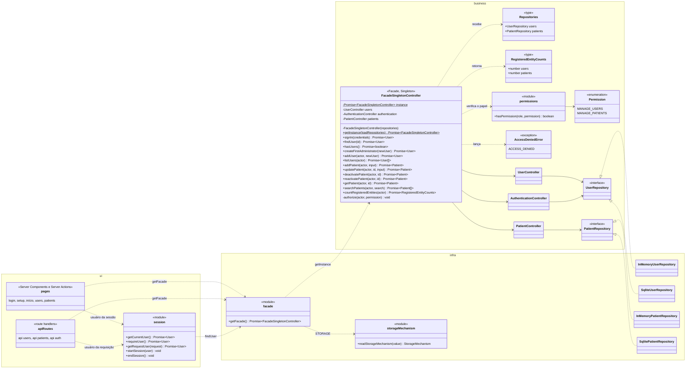
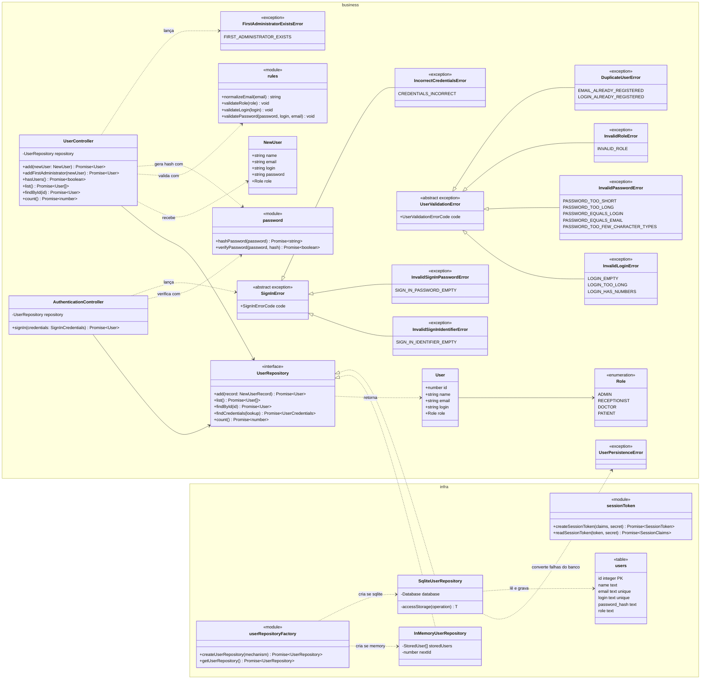
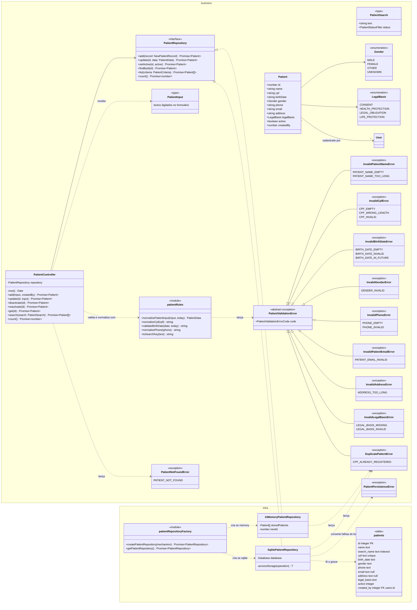

# Projeto detalhado — pacotes, classes de projeto e padrões

> Não existia no modelo .docx. Aqui fica o **diagrama de classes de projeto**, que evolui a cada sprint, diferente do diagrama de **análise** (`05-analise.md`), que é conceitual e muda pouco.
> Atualize este arquivo em **toda** sprint (ver [cronograma](00-entregas.md)). Os nomes de classes são os do código, em inglês ([ADR-0005](07-arquitetura/adr/0005-ingles-no-codigo-e-i18n.md)).

## 1. Divisão de pacotes

As camadas da disciplina (**ui**, **business** e **infra**) correspondem às pastas do aplicativo Next.js:

```text
src/
├── app/                         ← ui
│   ├── [locale]/
│   │   ├── (auth)/              ← telas sem sessão: /login (TL05) e /setup (TL06), com as Server Actions signIn e createFirstAdministrator
│   │   ├── (app)/               ← telas com sessão: início (TL07), patients (TL03, TL04) e users (TL01, TL02), com suas Server Actions
│   │   └── form-failures.ts     ← erro de domínio → campo e código mostrados no formulário
│   └── api/
│       ├── api-responses.ts     ← sessão, permissão e falhas comuns → { error: { code, message } }
│       ├── auth/                ← POST/DELETE /api/auth/session e POST /api/auth/first-administrator
│       ├── users/               ← GET e POST /api/users
│       └── patients/            ← /api/patients e /api/patients/[id]
├── components/                  ← ui: blocos de tela (menu lateral, cabeçalho, campos) e ui/ (shadcn/ui)
├── modules/                     ← business: uma pasta por capacidade
│   ├── facade/                  ← FacadeSingletonController e o tipo Repositories
│   ├── auth/                    ← AuthenticationController, permissões por papel e erros de login
│   ├── users/                   ← User, Role, regras, senha, erros, UserRepository e UserController
│   └── patients/                ← Patient, Gender, LegalBasis, regras, erros, PatientRepository e PatientController
├── infra/                       ← infra
│   ├── facade.ts                ← getFacade(): monta a fachada com os repositórios escolhidos por STORAGE
│   ├── storage-mechanism.ts     ← lê a variável STORAGE (memory ou sqlite)
│   ├── auth/                    ← sessão: token assinado (session-token.ts) e cookie (session.ts)
│   ├── users/                   ← InMemoryUserRepository, SqliteUserRepository e a fábrica
│   └── patients/                ← InMemoryPatientRepository, SqlitePatientRepository e a fábrica
├── db/                          ← infra: esquema Drizzle (users, patients), conexão e erros do banco
├── i18n/                        ← ui: idiomas e textos traduzidos (messages/)
└── proxy.ts                     ← escolhe o idioma e manda para /login quem não tem sessão
```

**Regra de dependência:** `ui` → `business` ← `infra`. A camada `business` não importa nada de `ui` nem de `infra`: cada controle recebe a interface do seu repositório, e a fachada recebe os repositórios pela função passada a `getInstance` ([ADR-0006](07-arquitetura/adr/0006-repositorio-de-usuarios.md), [ADR-0007](07-arquitetura/adr/0007-fachada-unica.md)). Telas, Server Actions e rotas de API chamam só a fachada, por `getFacade()`.

## 2. Diagrama de classes de projeto

### Estado atual: Sprint 3

O diagrama está dividido em três partes: a visão geral com a fachada, o módulo de usuários com a autenticação e o módulo de pacientes. Uma classe que aparece em mais de uma parte é a mesma.

#### 2.1 Visão geral: fronteiras, fachada e repositórios



#### 2.2 Usuários e autenticação



O login (RF06) procura o usuário pelo login exato ou pelo e-mail normalizado (`findCredentials`) e compara a senha com o hash em tempo constante (`verifyPassword`). Login inexistente e senha errada dão o mesmo erro, `IncorrectCredentialsError`, e um login inexistente também passa pelo scrypt, para que o tempo de resposta não revele quem está cadastrado. A sessão é um JWT assinado num cookie `httpOnly`, com o id e o login do usuário e validade de 8 horas; a cada requisição o usuário é lido de novo pela fachada ([ADR-0008](07-arquitetura/adr/0008-sessao-em-cookie-assinado.md)).

#### 2.3 Pacientes



O paciente guarda o CPF e o telefone só com os dígitos, e a coluna `search_name` guarda o nome em minúsculas e sem acentos (`toSearchKey`), usada na busca e na ordem alfabética (RF14). O repositório em RAM usa a mesma função, então os dois mecanismos devolvem a mesma lista. `Gender` segue o `AdministrativeGender` do FHIR R4 e `LegalBasis`, as bases legais da LGPD para dados de saúde (NF-PRI-01). A edição troca os dados, mas não muda a situação nem o autor (`createdBy`); a inativação só muda `active`, e não há exclusão (RF13).

### Os dois mecanismos de persistência

Os controles dependem só das interfaces `UserRepository` e `PatientRepository`. A variável `STORAGE`, lida uma única vez na inicialização (`readStorageMechanism`), escolhe o mesmo mecanismo para as duas entidades (NF-MAN-01, [ADR-0006](07-arquitetura/adr/0006-repositorio-de-usuarios.md)):

| `STORAGE` | Implementações | Comportamento |
|---|---|---|
| `memory` | `InMemoryUserRepository`, `InMemoryPatientRepository` | Coleções em RAM; os dados somem quando o processo termina |
| `sqlite` | `SqliteUserRepository`, `SqlitePatientRepository` | Tabelas `users` e `patients` no banco da `DATABASE_URL` (arquivo local ou Turso); os dados sobrevivem ao reinício |

As implementações de cada entidade passam pelos mesmos testes de contrato (`user-repository.contract.test.ts`, `patient-repository.contract.test.ts`). Falhas do banco são capturadas em `accessStorage` e convertidas em `UserPersistenceError` ou `PatientPersistenceError` (NF-CON-01). E-mail, login e CPF repetidos são barrados pelos índices únicos, inclusive em cadastros simultâneos. As regras lançam uma exceção por campo, e cada caso tem um código próprio; a interface mostra a mensagem desse código no idioma do usuário (`<capacidade>.errors.<código>` em `messages/`).

## 3. Padrões de projeto utilizados

Preencha uma linha por padrão aplicado. Cada padrão relevante também tem um ADR.

| Padrão | Sprint | Classes participantes (papel no padrão) | Problema que resolve no projeto | ADR |
|---|---|---|---|---|
| Singleton | S3 | `FacadeSingletonController` (singleton: construtor privado, campo estático `instance`, `getInstance`) | Os controles e os repositórios são montados uma única vez por processo, e todas as telas e rotas usam a mesma instância | [ADR-0007](07-arquitetura/adr/0007-fachada-unica.md) |
| Facade | S3 | `FacadeSingletonController` (fachada); `UserController`, `AuthenticationController`, `PatientController` (subsistema); páginas, Server Actions e rotas de API (clientes) | As fronteiras chamam um só objeto, com um método por caso de uso, e a verificação do papel (NF-SEG-02) fica num só lugar; `countRegisteredEntities` informa quantas entidades estão cadastradas | [ADR-0007](07-arquitetura/adr/0007-fachada-unica.md) |
| Repository | S4 | | | |
| Factory Method / Abstract Factory | S4 | | | |
| Adapter | S4 | | | |
| Template Method | S4 | | | |
| Command | S5 | | | |
| Memento | S5 | | | |
