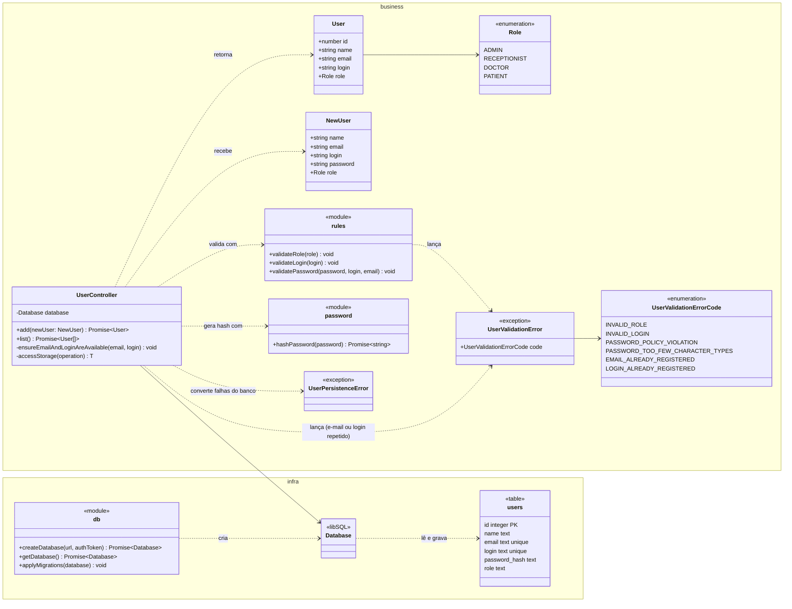

# Projeto detalhado — pacotes, classes de projeto e padrões

> Não existia no modelo .docx. Aqui fica o **diagrama de classes de projeto**, que evolui a cada sprint, diferente do diagrama de **análise** (`05-analise.md`), que é conceitual e muda pouco.
> Atualize este arquivo em **toda** sprint (ver [cronograma](00-entregas.md)). Os nomes de classes são os do código, em inglês ([ADR-0005](07-arquitetura/adr/0005-ingles-no-codigo-e-i18n.md)).

## 1. Divisão de pacotes

As camadas da disciplina (**ui**, **business** e **infra**) correspondem às pastas do aplicativo Next.js:

```text
src/
├── app/                ← ui: páginas em app/[locale]/ e rotas de API em app/api/
├── components/ui/      ← ui: componentes shadcn/ui
├── modules/            ← business: uma pasta por capacidade
│   └── users/
│       ├── user.ts             ← entidade: User, NewUser
│       ├── role.ts             ← enumeração: Role
│       ├── rules.ts            ← validação de login, senha e papel
│       ├── password.ts         ← hash da senha
│       ├── errors.ts           ← exceções: UserValidationError, UserPersistenceError
│       ├── user-controller.ts  ← controle: UserController
│       └── user-controller.test.ts
├── db/                 ← infra: esquema Drizzle (schema.ts) e conexão (index.ts)
└── i18n/               ← ui: idiomas e textos traduzidos (messages/)
```

**Regra de dependência:** `ui` → `business` → `infra`. A camada `business` não importa nada de `ui`; o `UserController` recebe o `Database` pelo construtor, então os testes usam um banco em memória.

## 2. Diagrama de classes de projeto

### Estado atual: Sprints 1 e 2



### Os dois mecanismos de persistência

A escolha é feita uma única vez, na inicialização, pela variável `DATABASE_URL`, sem alterar o `UserController` (NF-MAN-01, [ADR-0004](07-arquitetura/adr/0004-nextjs-typescript-sqlite.md)):

| Mecanismo | `DATABASE_URL` | Comportamento |
|---|---|---|
| Memória (RAM) | `:memory:` | `createDatabase` aplica as migrações na conexão; os dados somem quando o processo termina |
| Permanente | `file:local.db` (SQLite local) ou `libsql://<banco>.turso.io` (Turso) | Os dados sobrevivem ao reinício; o esquema é aplicado com `npm run db:migrate` |

Falhas do banco (arquivo inacessível, banco fora do ar, tabelas ausentes) são capturadas em `UserController.accessStorage` e convertidas em `UserPersistenceError` (NF-CON-01). As regras de login e senha lançam `UserValidationError` com um código estável, que a interface traduz para a mensagem do idioma do usuário (`messages/pt-BR.json`, `users.errors.<código>`).

## 3. Padrões de projeto utilizados

Preencha uma linha por padrão aplicado. Cada padrão relevante também tem um ADR.

| Padrão | Sprint | Classes participantes (papel no padrão) | Problema que resolve no projeto | ADR |
|---|---|---|---|---|
| Singleton | S3 | | | |
| Facade | S3 | | | |
| Repository | S4 | | | |
| Factory Method / Abstract Factory | S4 | | | |
| Adapter | S4 | | | |
| Template Method | S4 | | | |
| Command | S5 | | | |
| Memento | S5 | | | |
